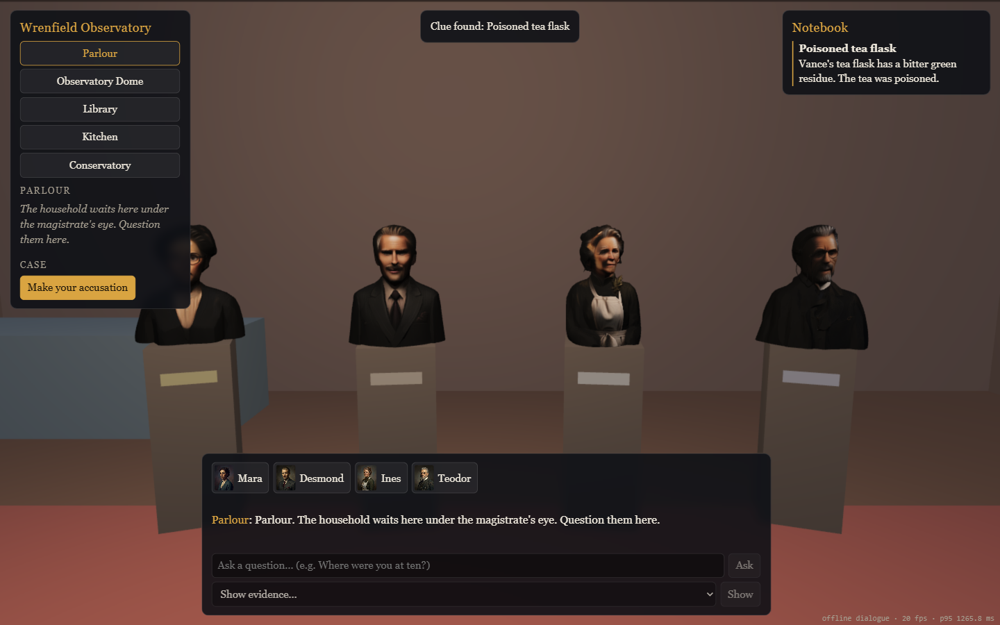
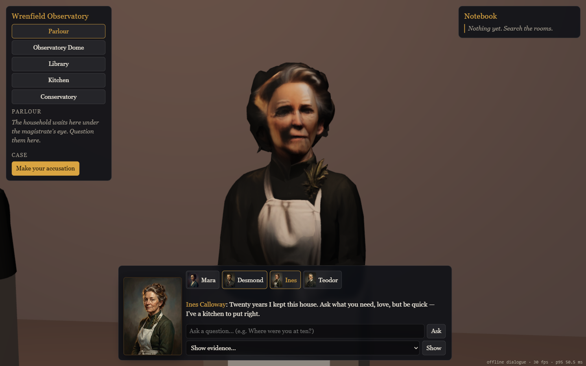
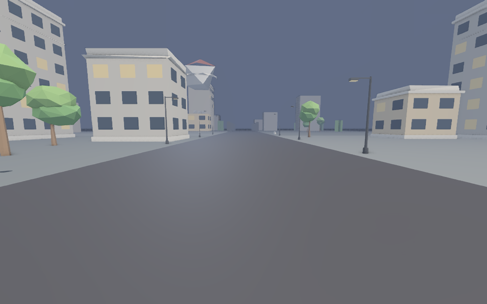

# AugEngine

**A web-native runtime for persistent, memory-bearing, guard-railed AI characters inside
deterministic game state, drivable by agents over MCP.**

[](https://github.com/mnemopay/augengine/actions/workflows/ci.yml)
[](https://www.npmjs.com/package/@mnemopay/augengine)
[](LICENSE)

AugEngine runs in the browser on WebGPU. Characters carry personas and memory, act only
through a game-rule action grammar that refuses verbs they were not granted, and live in
a fixed-step, Rapier-backed world. The same scene can be played by a person or driven by
an agent over the Model Context Protocol.

- Play the flagship slice: **[augengine.com/detective](https://augengine.com/detective)**
  (*The Wrenfield Observatory*). Its full source is in [`examples/detective`](examples/detective).
- npm: [`@mnemopay/augengine`](https://www.npmjs.com/package/@mnemopay/augengine) (alpha),
  [`@mnemopay/augengine-lod`](https://www.npmjs.com/package/@mnemopay/augengine-lod) (alpha)
- New here? Start with [`docs/GETTING-STARTED.md`](docs/GETTING-STARTED.md), then the
  [engine package README](packages/augengine/README.md) (60-second quick start, feature
  status table, MCP tool list).

| | |
| --- | --- |
|  |  |
|  | All three are real captures (`results/`), on an Intel UHD laptop in headed Chrome. |

## Where things stand (the gates)

AugEngine is measured against four gates. Honest status:

1. **Gate 1, frame budget: open.** 16.7 ms p95 on a shipping GPU is **not claimed**.
   Every published number comes from an Intel UHD laptop, where sprint p95 is about
   19 ms. No shipping-GPU benchmark has been run.
2. **Gate 2, world streaming: shipped as alpha** in 0.3.0-alpha.0. A 1 km streamed level
   with LOD, culling, instancing, per-tile terrain, nav and persistent NPC state. See
   [`results/stream-level/SCORECARD.md`](results/stream-level/SCORECARD.md).
3. **Gate 3, editor: shipped as alpha, not in this repository.** AugEngine Studio (browser
   editor plus an unsigned Windows build) lives in the development monorepo for now.
4. **Gate 4, a finished game: shipped as alpha.** The detective game, live at
   augengine.com/detective, source in [`examples/detective`](examples/detective).

Known gaps carried into the next release: generated characters have no lip-sync; Kokoro
voices need `@mnemopay/augengine-onnx`, which is not public yet. Full list in
[`packages/augengine/CHANGELOG.md`](packages/augengine/CHANGELOG.md).

## What's in this repository

| Path | What it is | On npm |
| --- | --- | --- |
| [`packages/augengine`](packages/augengine) | The engine: scene graph, WebGPU renderer, physics, streaming, characters, AI | `@mnemopay/augengine` (alpha) |
| [`packages/augengine-lod`](packages/augengine-lod) | LOD baking CLI + procedural city kit | `@mnemopay/augengine-lod` (alpha) |
| [`packages/augengine-mcp`](packages/augengine-mcp) | stdio MCP server: scene authoring, actions, observations, Godot export, detective tools | no |
| [`packages/augengine-detective`](packages/augengine-detective) | The detective game's core: case as deterministic state, rule engine, suspect personas, LLM-dialogue guardrails, offline fallback, per-player memory | no |
| [`examples/detective`](examples/detective) | *The Wrenfield Observatory*, the gate 4 game (Vite app + key-guarded dialogue API) | no |
| [`docs/`](docs) | [Getting started](docs/GETTING-STARTED.md), [characters](docs/CHARACTERS.md) | |
| [`results/`](results) | Measured scorecards and captures: [renderer benchmark](results/renderer-benchmark/SCORECARD.md), [streamed level](results/stream-level/SCORECARD.md), [proof room](results/proof-room/SCORECARD.md), [detective](results/detective) | |
| [`AUGENGINE-ARCHITECTURE.md`](AUGENGINE-ARCHITECTURE.md) | The architecture decision record (public edition) | |

Not in this repository (yet): AugEngine Studio and its desktop build, the agent-evaluation
server, the Unreal sidecar, `@mnemopay/augengine-onnx`, and the internal development
harnesses that produced the benchmark captures in `results/`. Some docs and scorecards
mention those by path.

## Build and test from a fresh clone

Needs Node 20 or newer.

```bash
git clone https://github.com/mnemopay/augengine.git
cd augengine
npm ci            # installs native prebuilds for sharp and better-sqlite3 (dev dependencies)
npm run build     # builds augengine-lod, augengine-detective and the engine, then the MCP server and the game
npm test          # unit tests (vitest) in every workspace
```

Measured on 2026-11-27 (Node 25.9.0 / npm 11.12.1, Windows) from a clean tree: `npm ci`
and `npm run build` succeed and `npm test` passes 983 unit tests in 5 workspaces (853 in the
engine, 51 detective core, 43 MCP server, 18 LOD, 18 game server), with 1 skipped: the
engine's native-substrate ABI check, whose package is not in this repository. CI runs the
same three commands on Ubuntu with Node 20 and 22.

Notes:

- **Build order matters.** The MCP server and the game import the engine and the
  detective core, so `npm run build` builds those first. Building workspaces in plain
  declaration order can fail on a clean checkout.
- The engine's `optional-deps-dist` test reads `packages/augengine/dist`, so run
  `npm run build` before `npm test`.
- **Kokoro voices** need `@mnemopay/augengine-onnx`, which is not in this repository;
  without it `KokoroTtsProvider.load()` throws an "Install …" error. Everything else
  works without it.
- Browser e2e tests (Playwright, headed Chrome with WebGPU) are separate:
  `npx playwright install chromium`, then `npm run e2e -w augengine-detective-game`.

Run things:

```bash
# Detective game (scripted dialogue with ?offline=1; model dialogue needs OPENROUTER_API_KEY in the environment)
npm run dev -w augengine-detective-game

# MCP server (after npm run build)
node packages/augengine-mcp/dist/cli.js tools          # print the tool manifest
node packages/augengine-mcp/dist/cli.js serve --stdio  # register this with your MCP client
```

## Contributing

See [CONTRIBUTING.md](CONTRIBUTING.md). This repository is a one-way mirror of the
development monorepo: pull requests are welcome, maintainers apply them upstream, and the
next sync brings them back here. Security reports: [SECURITY.md](SECURITY.md).

## License

Apache-2.0. See [LICENSE](LICENSE) and [NOTICE](NOTICE). Copyright 2026 Blackpig Films LLC.
