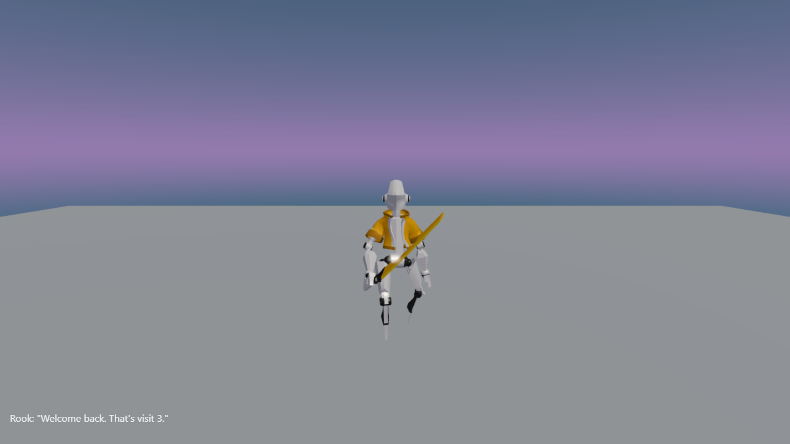

# Getting started with AugEngine

This guide takes you from an empty folder to a WebGPU scene with a floor, a sun, an
animated glTF character, and a persona that remembers you across page reloads. Then it
shows an agent driving a scene over MCP.

**Status: alpha.** The guide targets `@mnemopay/augengine@0.4.1-alpha.0` or newer. APIs can
change between alpha releases. On `0.4.0-alpha.0` the root import needs a Vite alias and
there is no `loadGltfIntoRenderer`, so install `0.4.1-alpha.0` or newer.

**How it was tested (2026-11-27):** a fresh `npm create vite@latest -- --template vanilla-ts`
project (Vite 8.4) outside this repo, with the packed `0.4.1-alpha.0` tarball and
`@mnemopay/sdk@latest` (1.17.0), and `index.html` / `main.ts` copied from this page. `main.ts`
typechecks, `vite build` succeeds, and in headed Chrome on Intel UHD (gen-11) three loads printed
"First time here?", then "visit 2", then "visit 3", under both `npx vite` and `vite preview`.



## What you need

- Node 18 or newer.
- A browser with WebGPU: current Chrome or Edge on desktop. AugEngine has no WebGL
  fallback, so `renderer.init()` throws when WebGPU is missing.

## 1. Install

```bash
npm create vite@latest my-scene -- --template vanilla-ts
cd my-scene
npm install @mnemopay/augengine@latest @mnemopay/sdk
```

The engine works without `@mnemopay/sdk`. This guide uses the SDK for in-process memory
(`createInProcessBrain`), which loads `@mnemopay/sdk/recall` the first time it is used. No Vite
configuration is needed.

Next, get a character. Any skinned `.glb` works. This guide uses the CC0 Quaternius robot
that AugEngine Studio bundles for retargeting:

```bash
mkdir -p public
curl -o public/character.glb https://augengine.com/assets/character.glb
```

## 2. The page

`index.html`:

```html
<!doctype html>
<html>
  <body style="margin:0;background:#111">
    <canvas id="game" style="width:100vw;height:100vh;display:block"></canvas>
    <p id="say" style="position:fixed;left:16px;bottom:16px;color:#eee;font:16px system-ui"></p>
    <script type="module" src="/main.ts"></script>
  </body>
</html>
```

## 3. The first scene

`main.ts` is about 40 lines of code. Each numbered comment marks one step.

```ts
import { Scene, Tag, loadGltfIntoRenderer, applyGltfAnimation,
  createInProcessBrain, createMnemoPayMemoryAdapter, type Entity, type EntityId } from "@mnemopay/augengine";
import { createLiveRenderer, lookAtTransform } from "@mnemopay/augengine/runtime/live";

// 1. Renderer (WebGPU only; throws if the browser has no WebGPU).
const canvas = document.getElementById("game") as HTMLCanvasElement;
canvas.width = canvas.clientWidth * devicePixelRatio;
canvas.height = canvas.clientHeight * devicePixelRatio;
const renderer = createLiveRenderer(canvas);
await renderer.init();
renderer.setSky(true);

// 2. Scene: a camera, a floor and a sun. Entities are plain data: an id plus components.
const id = (s: string) => s as EntityId;
const at = (position: [number, number, number]) =>
  ({ position, rotation: [0, 0, 0, 1], scale: [1, 1, 1], parent: null }) as const;
const entities: Entity[] = [
  { id: id("camera"), name: "Camera", components: {
      transform: { ...lookAtTransform([0, 1.6, 4], [0, 1, 0], [0, 1, 0]), parent: null },
      camera: { fovY: 0.9, near: 0.1, far: 200, active: true } } },
  { id: id("floor"), name: "Floor", components: { transform: { ...at([0, 0, 0]), scale: [20, 1, 20] },
      mesh: { geometry: { kind: "primitive", shape: "plane" }, visible: true,
        material: { kind: "pbr", baseColor: [0.18, 0.2, 0.22], metallic: 0, roughness: 0.9 } } } },
  { id: id("sun"), name: "Sun", components: { transform: at([3, 6, 4]),
      light: { kind: "directional", color: [1, 0.95, 0.85], intensity: 3 } } },
];
const scene = new Scene({ schemaVersion: 1, source: { kind: "authored", path: "first-scene" },
  entities, defaultCamera: id("camera") });

// 3. A glTF character: one call uploads its meshes and textures and adds its entities to the scene.
const { instance: rook } = await loadGltfIntoRenderer(renderer, scene, "/character.glb",
  { idPrefix: "rook", position: [0, 0, 0] });
const wave = rook!.animations.find((a) => a.name.endsWith("|Wave")) ?? rook!.animations[0];

// 4. A persona whose memory survives reloads (in-process brain, saved to localStorage).
const brain = createInProcessBrain({ loadRecall: () => import("@mnemopay/sdk/recall"),
  initial: JSON.parse(localStorage.getItem("rook-memory") ?? "[]"),
  onPersist: () => localStorage.setItem("rook-memory", JSON.stringify(brain.snapshot())) });
const memory = createMnemoPayMemoryAdapter({ client: brain, mode: "vector" });
scene.get(rook!.rootEntityId)!.components[Tag.Persona] =
  { traits: ["warm", "observant"], voice: null, memoryId: "rook", goals: [], mood: 0.2 };
const visits = await memory.recall("rook", "player visited", 50);
document.getElementById("say")!.textContent = visits.length
  ? `Rook: "Welcome back. That's visit ${visits.length + 1}."` : `Rook: "First time here?"`;
await memory.remember("rook", `player visited at ${new Date().toISOString()}`, ["visit"]);

// 5. Loop: animate, render.
const start = performance.now();
(function frame(now: number) {
  if (wave) applyGltfAnimation(scene, rook!, wave, (now - start) / 1000, { loop: true });
  renderer.render(scene);
  requestAnimationFrame(frame);
})(start);
```

What each step does:

1. **Renderer.** `createLiveRenderer` returns AugEngine's own WebGPU renderer.
   `setSky(true)` turns on the gradient sky.
2. **Scene.** A scene is plain data: entities with components such as `transform`, `mesh`,
   `light`, `camera` and `persona`. A directional light with no rotation shines from its
   position toward the origin.
3. **glTF.** `loadGltfIntoRenderer` fetches and parses the file, uploads each primitive (and
   its PBR textures, if any) under the key `gltf:<url>#<primitive>` that a
   `{ kind: "gltf", url }` mesh looks up, and adds the file's nodes, skin and clips to the
   scene as entities. Pass `null` as the scene to upload meshes only. `applyGltfAnimation`
   samples a clip every frame, and the engine skins the mesh on the GPU. The lower-level
   pieces (`loadGlb`, `buildGltfSceneInstance`, `renderer.uploadMesh`) are still exported if
   you need control over each step.
4. **Persona with memory.** The `persona` component holds traits and a `memoryId`.
   `createMnemoPayMemoryAdapter` turns any client that has `remember` and `recall` into the
   engine's `PersonaMemoryAdapter`. Here the client is `createInProcessBrain`: embedding and
   search run in the page, and `onPersist` saves each new memory to `localStorage`.
   `loadRecall` hands the brain your own import of `@mnemopay/sdk/recall` so Vite bundles it;
   without it, a bundled page gets an `Install @mnemopay/sdk …` error on the first memory call. That is
   how the robot knows you came back. To keep memory on a server instead, pass a hosted
   MnemoPay client (or `createBrainHttpClient`) to the same adapter.
5. **Loop.** Each frame, advance the animation and call `renderer.render(scene)`.

## 4. Run it

```bash
npx vite
```

Open the printed URL in Chrome. The robot waves and the corner reads
`Rook: "First time here?"`. Reload the page and it reads `Welcome back. That's visit 2.`
To reset the memory, delete the `rook-memory` key in DevTools under
Application > Local Storage.

## 5. Drive a scene from an agent over MCP

AugEngine has an MCP server (`packages/augengine-mcp`). An MCP client such as Claude Code,
Claude Desktop or Cursor can use it to build and drive scenes through typed tool calls.

**Availability:** the MCP server isn't on npm yet. Build it from the source repository,
[github.com/mnemopay/augengine](https://github.com/mnemopay/augengine):

```bash
git clone https://github.com/mnemopay/augengine.git
cd augengine
npm ci
npm run build      # builds the engine, the detective core and the MCP server, in that order
claude mcp add augengine -- node /abs/path/to/augengine/packages/augengine-mcp/dist/cli.js serve --stdio
```

Scene tools, with names exactly as the server lists them:

| Tool | What it does |
|---|---|
| `augengine_create_scene` | Turns a prompt into a SceneSpec. The same (prompt, seed) always gives the same spec. No model call. |
| `augengine_add_entity` | Adds an entity to a scene. |
| `augengine_attach_persona` | Attaches or replaces a persona (traits, memoryId, mood, voice). |
| `augengine_list_entities` | Lists entities by component tag or name pattern, with world positions. |
| `augengine_describe_scene` | Returns component counts, the verbs you can dispatch, and the available predicates and effects. |
| `augengine_dispatch_action` | Runs an action (verb, actor, target, preconditions, effects). |
| `augengine_subscribe_observation` | Opens a buffered subscription to one channel (Visual, Audible, Social, Inventory, Combat or Dialogue). |
| `augengine_poll_observation` | Drains queued events from a subscription. |
| `augengine_export_godot` | Writes a SceneSpec out as a Godot 4.4 `project.godot` and `Main.tscn`. The output hasn't been opened in a real Godot editor yet. |
| `augengine_render_clip` | Doesn't work over stdio. It needs a browser (WebGPU and WebCodecs), so it returns an error. |

Three detective tools let an agent play *The Wrenfield Observatory* under the same rules as a
human player: `detective_new_session`, `detective_status` and `detective_act`.

Here is a session run on 2026-11-27. It shows the requests and the important parts of each
response:

```text
augengine_create_scene      { "prompt": "a robot greeter in a courtyard at night", "seed": 7 }
  -> sceneId "scene_1": a camera, a dim blue directional light, a floor, a sky dome,
     and "npc_robot_0" with a persona and the verbs say / move / look / emote

augengine_attach_persona    { "sceneId": "scene_1", "entityId": "npc_robot_0",
                              "traits": ["warm", "observant"], "memoryId": "rook", "mood": 0.2 }
  -> { "ok": true }

augengine_subscribe_observation { "sceneId": "scene_1", "channel": "Dialogue" }
  -> { "subscriptionId": "sub_1" }

augengine_dispatch_action   { "sceneId": "scene_1", "action": { "verb": "say", "actor": "npc_robot_0",
                              "params": { "text": "Welcome back." }, "preconditions": ["actor_exists"],
                              "effects": ["emit_dialogue"], "source": "agent" } }
  -> { "ok": true, "appliedEffects": ["emit_dialogue"] }

augengine_poll_observation  { "subscriptionId": "sub_1" }
  -> events: [{ "channel": "Dialogue", "source": "npc_robot_0",
               "payload": { "kind": "dialogue.line", "text": "Welcome back.", "verb": "say" } }]
```

The `spec` returned by `augengine_create_scene` has the same `SceneSpec` shape that the
browser `Scene` constructor takes, so you can pass it to `new Scene(spec)` in place of the
hand-written scene in step 3.

## Known gaps (alpha)

- No one has measured a 16.7 ms frame on a shipping GPU yet (gate 1). On an Intel UHD laptop,
  the proof room and the streamed level run at about 57–58 fps, with p95 frame times just over
  16.7 ms (`results/proof-room/SCORECARD.md`, `results/stream-level/SCORECARD.md`).
- Generated characters: the auto-rig has no finger or face joints, and generated characters
  have no lip-sync.
- Kokoro voices need a package that is not public yet (`@mnemopay/augengine-onnx`).
- The MCP server is not on npm; build it from the source repository
  ([github.com/mnemopay/augengine](https://github.com/mnemopay/augengine)).
- The Studio desktop build for Windows is unsigned.

## Next

- Play a finished game built on the engine: <https://augengine.com/detective>
- Package: <https://www.npmjs.com/package/@mnemopay/augengine>
- Characters (import, retarget, IK, Add character): [CHARACTERS.md](CHARACTERS.md)
- Source: <https://github.com/mnemopay/augengine>
